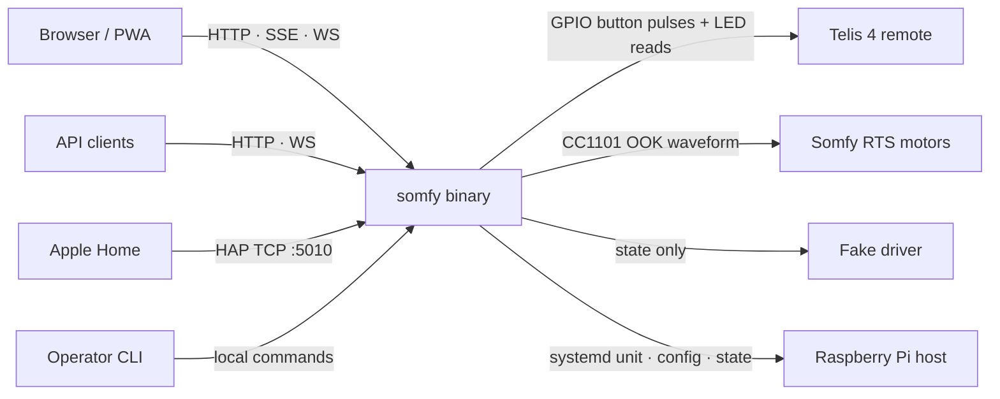
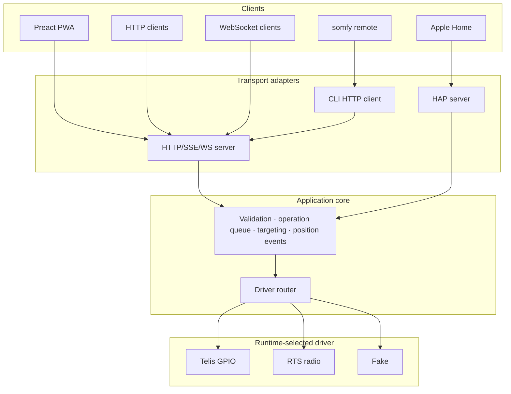
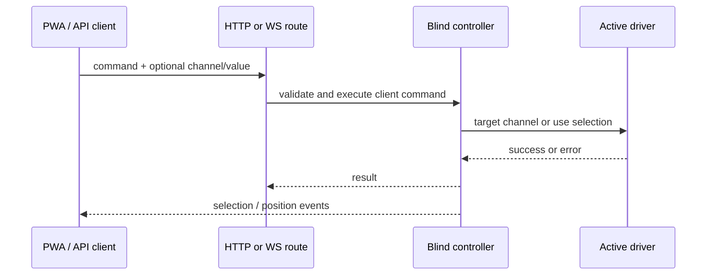
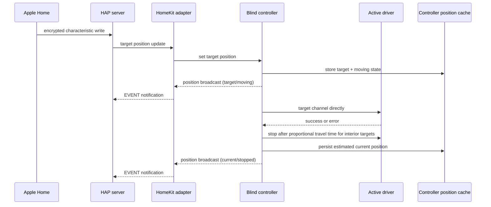

# Architecture

`somfy` is a single Rust binary that exposes one Somfy blind installation through a web UI, HTTP/SSE/WebSocket APIs, native HomeKit, and an operator CLI. The same command model drives three interchangeable hardware backends: a wired Telis remote, a direct RTS radio, or a fake driver for development.

The important architectural rule is that transports do not know which driver is active. Hardware selection is runtime configuration, while the user-facing control surface stays stable.

## System Context

At runtime there are two broad responsibilities in the binary:

- **Blind control:** accept commands, serialize hardware access, update live state, and publish position/selection events.
- **Host management:** install, upgrade, diagnose, configure, and operate the systemd service on the Pi.

The operator commands support the service, but they are not in the live command path. The reasoning behind the main design choices is collected in [Architectural Decisions](#architectural-decisions).

## Control Plane

The HTTP/SSE/WS server is axum, bound to `127.0.0.1:5002`; it validates requests (`src/service/`) before they reach the controller. HomeKit uses the same controller and driver router, but applies its own protocol semantics and accessory model before dispatching commands.

The CLI has two modes:

- Local operator commands such as `install`, `upgrade`, `doctor`, and `config` manipulate host state or service configuration.
- `somfy remote ...` acts like an API client and posts to the running service.

## Boundaries

### Transport Boundary

Transport adapters parse protocol-specific input and return protocol-specific output, but they never implement hardware behavior. `POST /command`, WebSocket text messages, and `somfy remote` all send the same JSON body, for example `{"command":"target","channel":"L2","value":50}`:

| `command`            | `channel` (`L1`-`L4`, `ALL`)                                       | `value`             |
| -------------------- | ------------------------------------------------------------------ | ------------------- |
| `up`, `down`, `stop` | Optional. Given: acts on that channel. Omitted: current selection. | —                   |
| `select`             | Optional. Given: selects it. Omitted: advances to the next one.    | —                   |
| `prog`, `prog_long`  | Required (pairing must name its channel). RTS driver only.         | —                   |
| `target`             | Optional, as for `up`.                                             | `0`-`100`, required |

`POST /command` answers `200` on success, `400` when validation rejects the request (including a pairing command the active driver can't perform), and `500` when the driver itself fails. A body that doesn't deserialize, such as an unknown `command`, is rejected earlier by axum's JSON extractor.

Live state is pushed through:

- SSE for the PWA's primary state stream.
- WebSocket for bidirectional API clients.
- HAP event notifications for Apple Home.

### Application Boundary

The application core owns the rules that should be consistent across clients:

- whether a command shape is valid;
- whether pairing commands are supported by the active driver;
- how optional target channels are resolved;
- when selection changes are broadcast;
- how inferred position updates are generated after movement commands.

The system has no motor position sensors. Position is an application-level inference: successful `up` maps to open (`100`), successful `down` maps to closed (`0`), and `target` moves from the cached current position to the requested percentage using [configured travel times](HARDWARE.md#timed-positioning). `ALL` fans out to the individual channels so HomeKit and API clients remain consistent.

### Driver Boundary

The driver router is the hardware seam. Every driver exposes the same command operations and selected-channel stream — the stream itself is one shared `driver::Selection` (the `watch` pair plus its accessors) rather than a per-driver copy — but each driver has different physical constraints:

| Driver  | Architecture Role                                                           | State Source              |
| ------- | --------------------------------------------------------------------------- | ------------------------- |
| `fake`  | Development and CI backend with no hardware effects.                        | In-memory state.          |
| `telis` | Presses a wired Telis 4 remote and reads LEDs to observe selected channel.  | Physical remote LEDs.     |
| `rts`   | Acts as five virtual RTS remotes (`L1`-`L4`, `ALL`) through a CC1101 radio. | Persisted RTS state file. |

All drivers are compiled into the binary. The active driver is selected by `/etc/somfy/config.toml` at startup. Without a config file, Linux ARM builds (the Pi) default to Telis and every other target defaults to fake.

## Runtime Flows

### Web Command

Request shapes are in the [Transport Boundary](#transport-boundary) table. Commands with an explicit channel act on that channel directly; `select` is the only command that changes the public selection.

### HomeKit Command

HomeKit is opt-in (`homekit = true` in config). It exposes four `WindowCovering` accessories: `L1`-`L4`. The HomeKit adapter translates target-position characteristic writes into controller target-position requests, then publishes the resulting position deltas back as HAP events. HAP protocol details and write semantics live in [HAP.md](HAP.md).

### RTS Transmission

Before emitting RF, the RTS driver reserves a block of rolling codes on disk, and it advances the in-memory code only after pigpiod has clocked the waveform out successfully. A crash may therefore skip unused codes. That is intentional: losing spare codes is safer than replaying an old code that a motor has already accepted. The step-by-step flow is in [RTS_DRIVER.md](RTS_DRIVER.md#transmission-flow).

## Concurrency Model

Blind operations are serialized at the controller boundary. HTTP, WebSocket, CLI remote, and HomeKit all enter the same controller queue before they reach a driver. This makes each client command atomic before it reaches driver-specific targeting or selection behavior.

Drivers still keep local locks around hardware resources:

- Telis uses one execution lock around GPIO output and selection sequences.
- RTS uses one transmission lock around radio configuration and pigpiod waveform operations.

The controller lock is the application-level ordering rule. Driver locks are internal safety guards for hardware resources and driver state; they remain useful if driver code is tested directly or a future path accidentally bypasses the controller.

WebSocket commands are spawned as their own tasks, so connection keepalives and selection updates keep flowing while a command waits behind the controller queue.

Selection notifications and position broadcasts are separate from operation and hardware locks, so observers can continue receiving state while a command is queued or executing.

Live state uses two notification channels:

- **Selection** — `watch` from the active driver through `BlindController::subscribe_selection()`; consumed by SSE `/events` and WebSocket.
- **Positions** — `BlindController::subscribe_positions` broadcast after inferred moves and timed motion, always emitted outside the operation lock. The controller never calls into HAP: HomeKit consumes this broadcast through a single bridge task (see [HAP.md](HAP.md#connection-lifecycle)). Don't add a controller-side HAP sink or callback.

These locks are correctness mechanisms, not trust boundaries. They prevent malformed timing and state races; they do not authenticate clients.

## Persistence

Runtime state lives in `$STATE_DIRECTORY` (set by systemd's `StateDirectory=somfy`), else `SOMFY_STATE_DIR`, else `/var/lib/somfy` in release builds and `./hap-state` in debug builds.

| File             | Owner                                   | Purpose                                                                   |
| ---------------- | --------------------------------------- | ------------------------------------------------------------------------- |
| `rts.json`       | RTS driver                              | Virtual remote IDs, selected RTS channel, and rolling-code reserves.      |
| `hap.json`       | HAP state                               | HomeKit identity, setup data, long-term key, config number, and pairings. |
| `positions.json` | Position cache (`positioning/state.rs`) | Last inferred blind positions per accessory (read-only on reload).        |

State files are written with a temp-file plus atomic rename pattern. Security-sensitive HomeKit state is stored with restrictive permissions. The service does not replay persisted positions into GPIO or RF on startup; position state is for client continuity, not physical reconciliation.

## Deployment Architecture

The release artifact is one binary:

- clap subcommands provide the operator and remote CLI;
- the axum server serves HTTP, SSE, WebSocket, and embedded PWA assets on `127.0.0.1:5002`;
- when `homekit = true`, the HAP server runs a separate TCP listener on port `5010`;
- driver implementations are all present and selected by config;
- build metadata is embedded at compile time for `--version`, `doctor`, and upgrade reporting.

`somfy install` writes the systemd unit and prepares driver prerequisites. If the resolved driver is RTS, install/configuration also ensures pigpiod is loopback-only because pigpiod has no authentication. `somfy upgrade` downloads a new release, verifies it, swaps the binary, restarts the service, and rolls back if the replacement fails to come up.

`somfy doctor` is the deployment health contract. It checks unit drift, service state, permissions, updates, deployed version, and driver-specific prerequisites. HomeKit pairing lifecycle is intentionally kept under `somfy homekit ...`.

## Architectural Decisions

| Decision                      | Why It Exists                                                                                   | Tradeoff                                                                 |
| ----------------------------- | ----------------------------------------------------------------------------------------------- | ------------------------------------------------------------------------ |
| Runtime driver selection      | One UI/API can support wired Telis, direct RTS, and development without rebuilding.             | Driver-specific behavior must be normalized at the application boundary. |
| One controller queue          | Client commands, GPIO pulses, selection changes, and RF transmissions never interleave.         | A slow command delays every other client's command.                      |
| Single self-managing binary   | The Pi is an appliance: install, upgrade, health checks, and rollback ship in the CLI.          | Deployment logic (systemd, pigpiod setup, rollback) lives in this repo.  |
| Telis LEDs as selection truth | The physical remote may be changed outside the app, so LEDs are the most accurate state source. | Selection changes require debounce logic and GPIO input wiring.          |
| RTS write-ahead rolling codes | Prevents replay after crashes or partial transmissions.                                         | Crashes can intentionally burn unused reserved codes.                    |
| Native HAP server             | Removes Homebridge and Node from the appliance.                                                 | The repo owns HAP protocol, crypto, pairing, and event semantics.        |
| pigpiod for RTS timing        | 640 microsecond Manchester half-symbols need timing outside the async runtime.                  | The Pi must run a local pigpiod daemon locked to loopback.               |
| Inferred positions            | Gives HomeKit and the UI useful state without motor encoders.                                   | State is a timing-based estimate, not measured blind position.           |

## Related Docs

- The file-by-file code map lives in [CLAUDE.md](../CLAUDE.md#repo-layout).
- [HARDWARE.md](HARDWARE.md) covers Telis wiring, CC1101 setup, GPIO behavior, and pairing workflows.
- [RTS_DRIVER.md](RTS_DRIVER.md) is the protocol reference for RTS frames, waveform timings, rolling codes, pigpiod, and CC1101 configuration.
- [HAP.md](HAP.md) covers HomeKit pairing, persistent identity, characteristic behavior, encrypted sessions, and event push.
